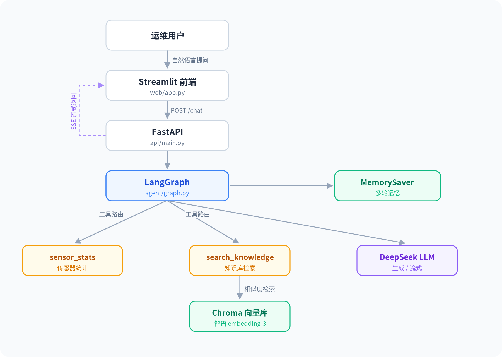
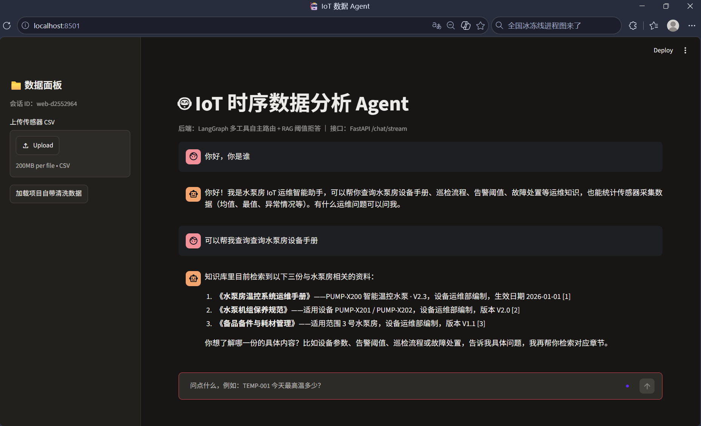

# IoT 设备时序数据分析 Agent

## 业务背景
水泵房每天产生海量时序数据（泵压、温度、振动），运维靠人工盯盘、查手册——慢且容易漏。
本项目是一个 IoT 设备运维 Agent：运维用自然语言提问
（"PUMP-X201 昨晚为什么报警？""TEMP-001 这周温度趋势？"），
Agent 自动查询实时数据、检索运维手册，给出带引用来源的诊断结论。

## 技术栈
LangGraph · Chroma · FastAPI · DeepSeek · 智谱 embedding-3 · RAGAS

## 架构图
   

## 评测指标
RAGAS 离线评测（三阶段 + Rerank）：

| 指标 | 说明 | 建库前 | 扩库没优化 | 扩库优化后 | +Rerank |
|---|---|---|---|---|---|
| Faithfulness（忠实度） | 回答是否忠于检索内容、不编造 | 0.614 | 0.637 | 0.753 | 0.802 |
| Answer Relevancy（答案相关性） | 回答是否切题 | 0.591 | 0.627 | 0.789 | 0.826 |
| Context Precision（上下文精确率） | 检索结果中相关片段占比 | 0.875 | 0.550 | 0.894 | 0.980 |
| Context Recall（上下文召回率） | 回答所需信息是否都被检索到 | 0.771 | 0.658 | 0.975 | 0.960 |

- **建库前**：仅 iot_manuals 7 chunks，距离阈值 1.2。
- **扩库没优化**：新增 5 类手册后检索被稀释，Context Precision 0.875→0.550、Recall 0.771→0.658。
- **扩库优化后**：结构化切分合并 + 距离阈值重标定（1.12）+ 补全「冷却液补充」小节 + 域门黑名单化，四项指标均超过建库前。
- **+Rerank**：在「扩库优化后」链路接入 BGE Reranker-v2-m3 精排，向量召回 20 条候选后精排取 3 条。

> faithfulness / answer_relevancy 受 DeepSeek n=1 评测噪声影响，存在约 ±0.05 波动。
>
> 注：answer_relevancy 从 0.627 涨到 0.789，主要靠两个修复：检索优化 + 域门黑名单化
> （此前白名单误杀 3 道"假拒答"——停电恢复/历史数据/三点复测，修复后相关度由 0 回到正分）。
> 剩余未达 0.8 的差距，来自少数"诚实声明资料未说明"的回答被 RAGAS 判 0 分——
> 「忠实度↑ ↔ 相关度↓」的固有权衡。


## 评测基线
| 指标 | 数值 | 说明 |
|---|---|---|
| Hit Rate@3 | 100%（25/25） | 5类分层测评集，检索命中率 |
| 拒答准确率 | 100%（5/5） | 库外问题正确拒答 |
| 知识库规模 | iot_manuals 44 chunks | 距离阈值 1.12 |

## 前端页面展示
   

## 快速启动
1. pip install -r requirements.txt
2. 复制 .env.example 为 .env，填入你的 API Key
3. python rag/build_index.py        # 建向量库
4. uvicorn api.main:app --port 8000 # 启动后端（终端 A）
5. curl http://127.0.0.1:8000/health            # 应返回 {"status":"ok"}
   curl -X POST http://127.0.0.1:8000/chat -H "Content-Type: application/json" -d "{\"message\":\"PUMP-X201 的告警阈值是多少？\"}"
6. streamlit run web/app.py       #启动前端（终端B）

> 注：Python 3.14 下 ragas 的依赖 scikit-network 无 cp314 wheel、需 MSVC 编译，`pip install -r requirements.txt` 会卡在它上面。
> 但它只在 ragas 生成测试集时用到，跑 faithfulness/answer_relevancy/context_recall 三指标评测不需要。
> 本项目 `.venv` 已用 `pip install ragas==0.4.4 --no-deps` 跳过它装好；全新复现时同样用 `--no-deps` 装 ragas、再补齐其余依赖即可。

> 注：国内直连 HuggingFace 会被墙（HTTP 502），下载模型需走镜像。运行 BGE reranker（`python -m rag.rerank`）前先设：
> `export HF_ENDPOINT=https://hf-mirror.com`（PowerShell 用 `$env:HF_ENDPOINT="https://hf-mirror.com"`）。
> 首次会下载约 1.1GB 模型，之后走本地缓存。

## 分支管理

采用 main / dev 双分支：

| 分支 | 用途 |
|---|---|
| `main` | 稳定可展示版本，每个里程碑收敛后从 dev 合并，保证 clone 下来就能直接跑通 |
| `dev` | 日常开发分支，新功能、实验、评测先行落地于此 |

开发流程：

```bash
# 日常开发在 dev
git checkout dev
git add . && git commit -m "feat: ..."
git push

# 里程碑稳定后，把 dev 合并进 main 作为发布快照
git checkout main
git merge dev          # 想保留合并记录可用 --no-ff
git push
```

> 约定：`main` 只放「能跑、能展示」的稳定版本，`dev` 才是日常开发的战场。


## 技术栈

- **编排**：LangGraph（StateGraph + MemorySaver 会话记忆）
- **LLM**：DeepSeek-chat（openai 兼容，temperature=0.2）
- **Embedding**：智谱 embedding-3；**Rerank**：BGE Reranker-v2-m3
- **向量库**：Chroma（多知识库隔离：iot_manuals / iot_reports）
- **后端**：FastAPI（全异步 + SSE 流式 /chat/stream）
- **前端**：Streamlit
- **评测**：RAGAS（Faithfulness / Answer Relevancy / Context Precision / Context Recall）
- **部署**：Docker + docker-compose
- **测试**：pytest（单元测试 + 接口集成测试）

## 个人职责

- 基于 LangGraph 编排「检索 + 数据分析」双工具 Agent，用 tools_condition 实现工具自主路由，
  以 MemorySaver 支撑多轮会话记忆（thread_id 隔离）。
- 自建水泵房运维多知识库 RAG：结构化切分 + 段落贪心合并（44 chunks），
  接入 BGE Reranker 做交叉编码精排，检索链路 answer_relevancy 0.619 → 0.789，
  context_recall 0.658 → 0.975，Hit Rate@3 25/25。
- 设计「域外黑名单 + 距离阈值 + 编码精确命中」三级拒答机制，
  将无关问题拒答准确率做到 5/5，修复 3 道假拒答（白名单 → 黑名单）。
- 用 FastAPI 重写后端入口为全异步，新增 SSE 流式端点（逐 token 输出）。
- 搭建 Docker Compose 一键部署（后端 + 前端 + 数据卷持久化），落地 pytest 单测与集成测试。
